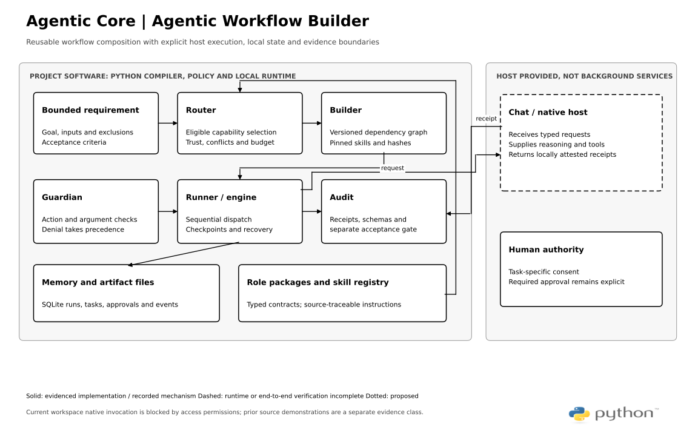
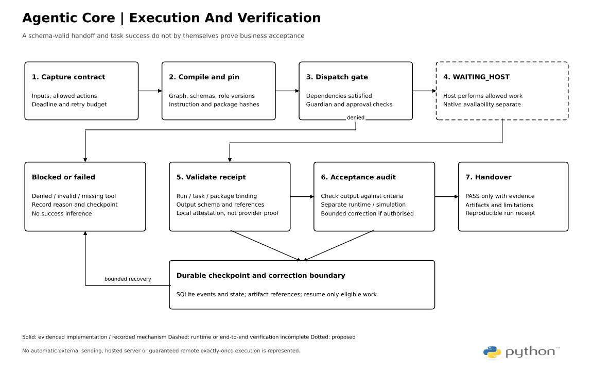

# Agentic Core

## Agentic Workflow Builder

Agentic Core is Jyothesh Karnam's independent project for turning bounded requirements into reusable workflows and checking execution against explicit acceptance criteria. The latest implementation is a Python and SQLite MVP using native desktop host reasoning. It has no web server or independent background agents.

This repository preserves an earlier MOA-led control-plane record. The newer MVP source excerpt lives in `runtime/` on this review branch. The full local native-plugin release is a separate verified artifact. Do not infer that historical repository components were all migrated or retested by the newer build.

## Contribution and Host Boundary

Project code provides typed requirements and task graphs, deterministic capability routing, permission checks, version and instruction pins, persistent state, checkpoints, retries, evidence handling and acceptance checks. The desktop host supplies model reasoning and supported tools. The library's methods are original source-derived adaptations, not vendor-endorsed integrations.

A generated workflow package solves a particular business problem. Agentic Core composes and executes that package; the builder and its resulting application remain distinct.

## Architecture

Requirement and constraints -> host-authored typed specification -> capability routing and graph compilation -> pinned package -> Guardian dispatch checks -> sequential local/WAITING_HOST tasks -> receipts and state -> business acceptance -> reusable export.

SQLite persists runs, tasks, approvals and events. No matching permission rule means denial. Approval and receipt identities are locally attested, not provider signatures. Model receipts bind request hashes and schemas. Resume preserves valid checkpoints. Ambiguous external outcomes stop for reconciliation rather than blind retry.





Diagram legends distinguish implemented, unverified and proposed elements. Host-tool boundaries remain independent of engine dispatch controls.

## Inspect and Test the Sanitized Source Excerpt

From `runtime/`, use Python 3.11 or later with jsonschema installed:

```powershell
python -m venv .venv
.\.venv\Scripts\python.exe -m pip install -r requirements.txt
.\.venv\Scripts\python.exe -B -m unittest discover -s tests -p "test_core*.py" -v
```

The excerpt contains the actual five core modules and two original synthetic test modules. It demonstrates contracts, routing, policies, SQLite lifecycle and recovery. It omits the plugin installer, 100-package library, native reasoning adapter and real operational records. It is not the full chat product. No network calls, model calls or business sends occur in its tests.

For the complete local release, the original setup uses `scripts/setup.ps1`, `agentic.py health`, `scripts/verify.py --full` and the documented support/onboarding demonstration commands. Native calls need a signed-in supported Codex host. Reading stored acceptance evidence is replay, not a new native call.

## Verified Scope

| Evidence | Result | Interpretation |
|---|---|---|
| Latest build source suite | 60 tests PASS in saved release report | Unit, integration and security scope of that build |
| Fresh candidate review | 35 core tests PASS | Actual bounded source rerun, not all 60 |
| Skill library |100 packaged / 100 structural / 700 contract fixtures / 15 method checks | Structural and deterministic qualification |
| Composed native demonstrations |5 skills,24 support cases,12 onboarding cases,3 repeat cases | Small synthetic case coverage |
| Role plugin installation |11 installed/enabled in recorded build | Separate from skill-library installation |
| Direct-model support baseline |Also PASS | No accuracy gain demonstrated |
| Exact release archive |2024 file hashes and extracted setup/verification PASS | Recorded delivered artifact integrity |

The library report records zero native-installed shared skills. Eleven role plugins access the packaged library. Ninety-nine packages meet local host prerequisites, and one optional external adapter requires a separate connection and authority.

## Limitations and Roadmap

Current SOL workspace invocation hit a Windows access error creating its runtime directory despite a successful earlier build-host invocation. Broader skill behavior, production reliability and unattended operation are not established. Guardian is engine-scoped, SQLite is local, and remote actions have no exactly-once guarantee. Existing MOA remained enabled. SOL applies related design principles, but direct integration with this new runtime is not demonstrated.

Next steps are resolve supported workspace invocation, expand independent synthetic behavior coverage, and review any new adapters before connection. No autonomous migration or external-action authority is implied.

## Privacy and Attribution

Keep this repository private. Recruiter-facing materials use an accessible case study or source available on request. Never commit credentials, CVs, application histories, recipient details, private transcripts or Amazon confidential material. These projects are independent of Amazon. The source excerpt uses Python's standard library, SQLite and jsonschema. The full skill library retains its source inventory and third-party notices; no vendor connection is inferred from a source reference.
